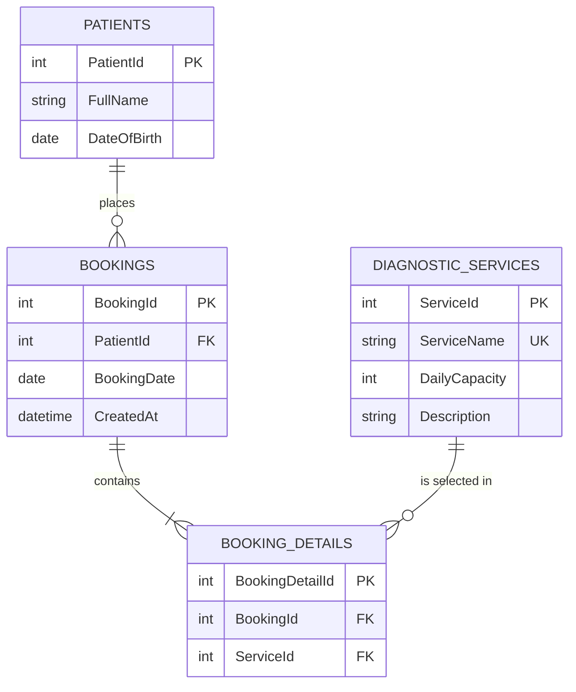

# CareFlow relational design

`BookingDetails` has a unique index on `(BookingId, ServiceId)` so one service cannot be stored twice on a booking. The booking service validates the required one-to-three detail count. Foreign keys preserve patient, booking, and service references. Remaining daily capacity is calculated by counting `BookingDetails` joined to `Bookings` for the selected date.
